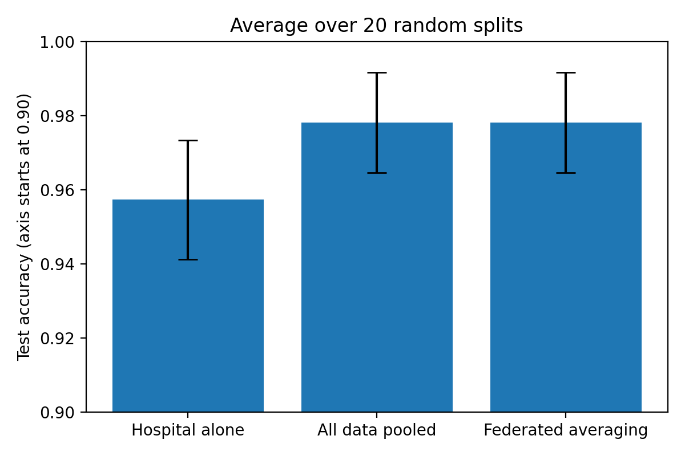
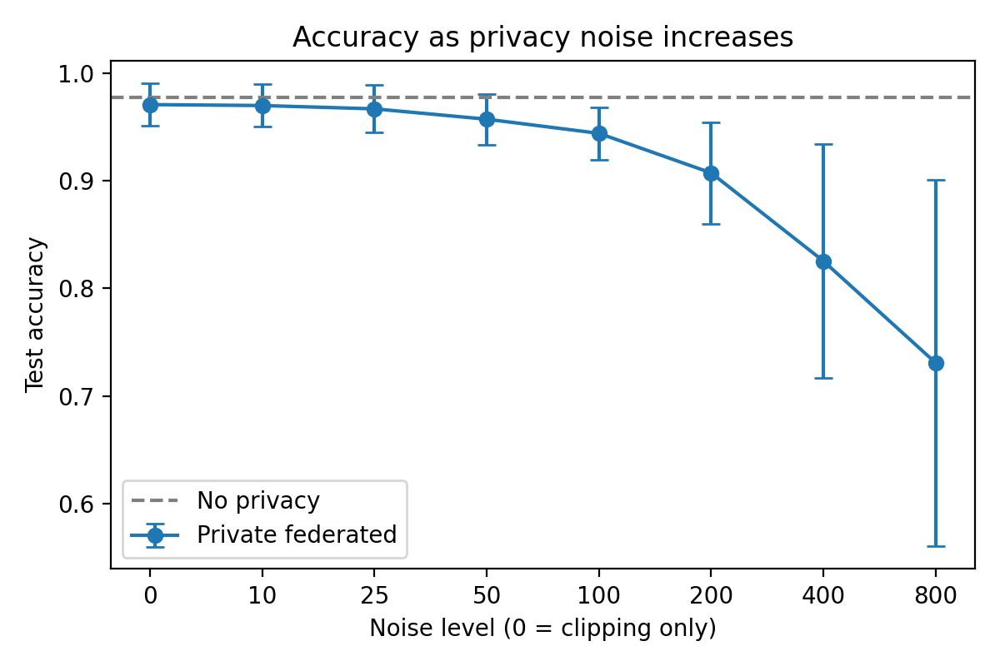
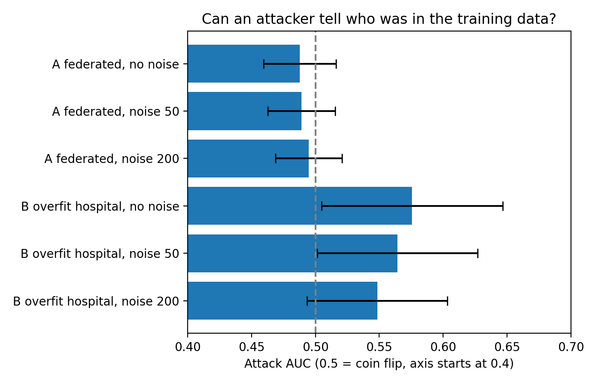
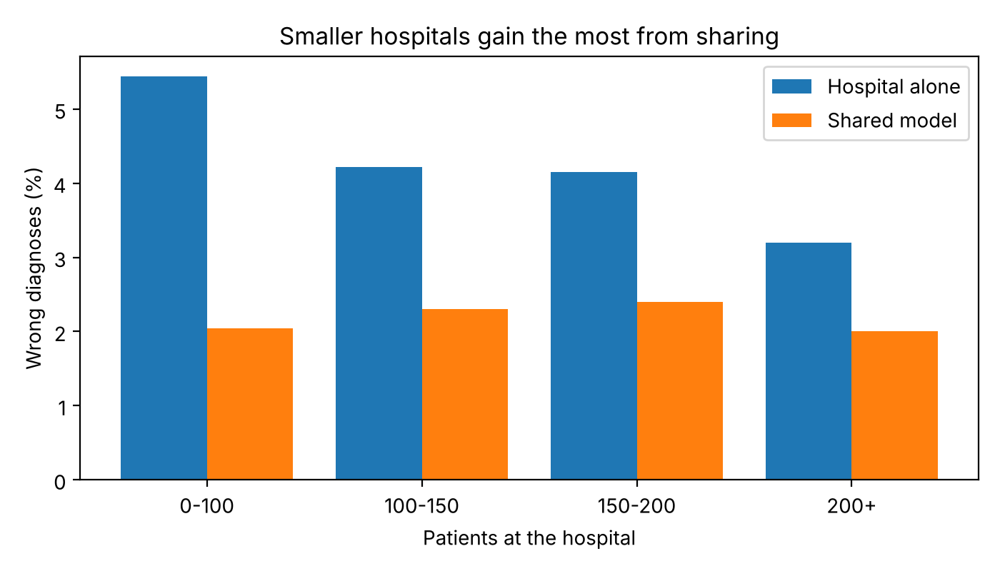
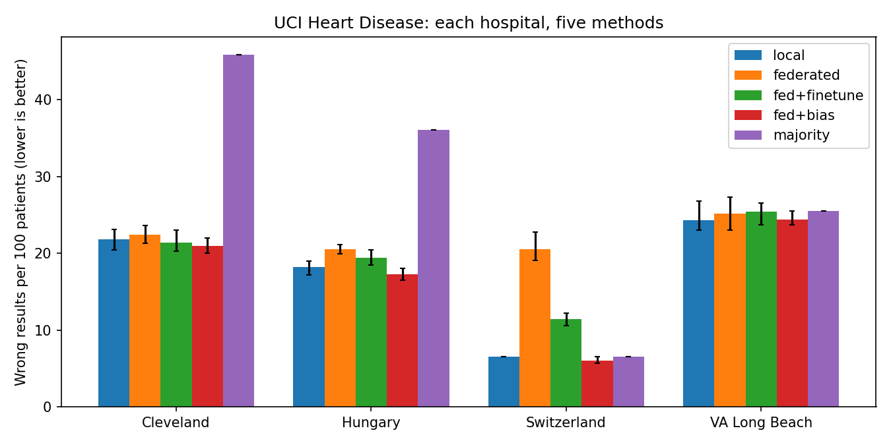

# Federated Hospitals Simulation
 
A small experiment on how hospitals can train a shared medical AI model without sharing patient data. It compares training at one hospital alone, training on pooled data, and federated learning, then tests two privacy questions: what privacy noise costs in accuracy, and whether an attacker can tell who was in the training data.
 
## Background
 
This project follows my published literature review:
 
Gupta, S. (2026). "AI for Healthcare: How Can Hospitals Share Data to Build Better Models?" *International Journal of Innovative Research in Computer and Communication Engineering (IJIRCCE)*, 14(8). DOI: [10.15680/IJIRCCE.2026.1408009](https://doi.org/10.15680/IJIRCCE.2026.1408009)
 
The review surveyed federated learning, synthetic data, differential privacy and homomorphic encryption, and noted that it did not test any method experimentally. This repository is a small experiment in that direction, covering federated learning and differential privacy. It does not test synthetic data or homomorphic encryption.
 
## Why this matters
 
My review found that a single hospital often has too few patient records to train a reliable AI model, and that privacy rules make it hard to pool records with other hospitals. This suggests that patients at smaller hospitals could be affected most, because a screening or diagnosis tool trained on fewer records may be less accurate. The review did not test this, so the simulation below does.
 
This simulation tests the idea that hospitals can share what they learn without sharing patients. In plain terms:
 
- A hospital using only its own data got about 4 to 5 wrong results in every 100 patients.
- Hospitals training one shared model, with no patient records leaving any building, got about 2 in every 100. This matched what pooling all the records into one place achieved.
- The smallest hospitals gained the most. Hospitals with under 100 training patients went from about 5.4 wrong in 100 to about 2.0 wrong in 100.
For a hospital that screens 5,000 patients a year, that is roughly 170 fewer wrong results a year in this simulation. This is an illustration from one public dataset, not a measured outcome in a real hospital. Real hospitals would need to test it on their own data.
 
The simulated hospitals are random slices of one dataset, so they are very similar to each other. A second test on four hospitals’ public data gave a less clear picture, described in the section “Second dataset: four hospitals (UCI Heart Disease)” below.
 
## For hospitals and doctors
 
The estimator below turns the simulation results into numbers for a hospital of a given size. Run it from the main folder after running the experiments:
 
```
python src/run_size_analysis.py
python src/impact.py --patients-in-training 80 --screened-per-year 5000
```
 
Example output:
 
```
Out of 5,000 patients a year:
  Own model only:  about 272 wrong results (5.4%)
  Shared model:    about 102 wrong results (2.0%)
  Difference:      about 170 fewer wrong results
In the simulation, 93% of similar hospitals did better in the shared model and 0% did worse (15 simulated hospitals).
This is based on one small public dataset. Test on your own data first.
```
 
What a hospital would need to try this for real: a labelled dataset of its own, agreement from at least two other hospitals, a shared agreed list of measurements, and approval from its data protection and ethics team. The shared model is trained by sending model updates, not patient records, but updates can still leak a little, which is why the privacy experiments below matter.
 
## What it does
 
- Uses scikit-learn's built-in Wisconsin breast cancer dataset (569 patients, 30 measurements each).
- Holds out 20% of patients as a test set (114 patients), and splits the other 455 between 3 simulated hospitals with deliberately different patient mixes.
- Implements logistic regression, federated averaging, and differential-privacy-style training (per-patient gradient clipping plus Gaussian noise) from scratch in NumPy.
- Repeats every experiment on many random splits and reports averages and spread.
## Results
 
All numbers are averages over 20 random splits, shown as mean ± standard deviation. Of 30 splits tried, 20 were usable: a split was skipped if any hospital had fewer than 5 patients of either class.
 
### 1. Hospital alone vs pooled vs federated
 
| Method | Accuracy | AUC |
|---|---|---|
| Hospital alone (average of 3) | 0.957 ± 0.016 | 0.992 ± 0.006 |
| All data pooled | 0.978 ± 0.013 | 0.994 ± 0.005 |
| Federated averaging | 0.978 ± 0.013 | 0.994 ± 0.005 |
 

 
Federated training matched pooled training, without any patient data leaving a hospital. Pooled training beat the hospital-alone models on all 20 splits, by 2.1 percentage points on average. The error bars overlap because the spread between splits is similar in size to the gap.
 
### 2. Cost of privacy noise (federated)
 
| Noise level | Accuracy |
|---|---|
| No clipping, no noise | 0.978 |
| 0 (clipping only) | 0.971 |
| 10 | 0.970 |
| 25 | 0.967 |
| 50 | 0.957 |
| 100 | 0.944 |
| 200 | 0.907 |
| 400 | 0.825 |
| 800 | 0.731 |
 

 
Clipping alone cost about 0.7 percentage points. Accuracy only starts to drop clearly from a noise level of about 50. My first attempt tested noise levels up to 16 and showed no effect at all, so I widened the range. Each hospital has only 100 to 200 patients, and the noise is divided by that number.
 
### 3. Can an attacker tell who was in the training data?
 
A loss-based membership inference attack: guess "member" for patients the model is least surprised by. Attack AUC of 0.5 means the attacker is guessing.
 
| Setting | Attack AUC |
|---|---|
| A: federated model, no noise | 0.488 ± 0.028 |
| A: federated model, noise 50 | 0.489 ± 0.026 |
| A: federated model, noise 200 | 0.495 ± 0.026 |
| B: overfit hospital model, no noise | 0.576 ± 0.071 |
| B: overfit hospital model, noise 50 | 0.564 ± 0.063 |
| B: overfit hospital model, noise 200 | 0.548 ± 0.055 |
 

 
- **Experiment A** uses the simple model from the other experiments. The attack does no better than guessing, so this model leaks almost nothing and the noise has nothing to improve.
- **Experiment B** uses a model I deliberately made prone to overfitting (squared features, 495 inputs, long training, one small hospital) to check that the attack works when there is something to find. It leaks a little, and more noise lowers the attack's success. The spread is large, so this is suggestive, not proven.
### 4. Who gains most from sharing?
 
Hospitals were grouped by how many training patients they had. Smaller hospitals gained the most, which is the group my review said is hurt most by limited data.
 
| Training patients | Wrong alone | Wrong in shared model | Hospitals better off | Hospitals worse off |
|---|---|---|---|---|
| Under 100 | 5.4% | 2.0% | 93% | 0% |
| 100 to 149 | 4.2% | 2.3% | 81% | 6% |
| 150 to 199 | 4.2% | 2.4% | 67% | 7% |
| 200 or more | 3.2% | 2.0% | 57% | 7% |
 

 
Each row has only 14 to 16 simulated hospitals, so these are rough estimates. The pattern is consistent across the rows, but the exact percentages should not be over-read. A small share of hospitals did slightly worse in the shared model, so sharing is not a guaranteed win for every hospital.
 
## Second dataset: four hospitals (UCI Heart Disease)
 
The breast cancer experiment above slices one dataset into pretend hospitals. This experiment uses the UCI Heart Disease dataset, which was collected at four separate hospitals: Cleveland and VA Long Beach (USA), Hungary, and Switzerland (920 patients in total). It is public data from four hospitals, not a test run inside real hospitals. The question is the one my first experiment could not ask: does a model shared across hospitals help or hurt each individual hospital?
 
What was done:
 
- The outcome is "any heart disease" versus none.
- Each hospital prepares its own data (filling gaps and scaling) using only its own training patients, so nothing is shared before training. This also removes the scaler problem noted under Limitations for the breast cancer experiment.
- Five methods are compared at every hospital: a model trained on that hospital alone (local), one shared model from federated averaging (federated), the shared model adjusted on the hospital's own patients (fed+finetune), the shared model with only its starting point re-fitted on the hospital's own patients (fed+bias), and always guessing the hospital's most common outcome (majority).
- Every patient is tested with 5-fold cross-validation inside their own hospital, repeated 20 times with different random folds.
- Slope, ca and thal are left out because they are missing for most patients at three of the four hospitals.
Wrong results per 100 patients (mean over 20 repeats, lower is better):
 
| Hospital | Patients | Have heart disease | Local | Federated | Fed+finetune | Fed+bias | Always guess majority |
|---|---|---|---|---|---|---|---|
| Cleveland | 303 | 46% | 21.8 | 22.4 | 21.4 | 21.0 | 45.9 |
| Hungary | 294 | 36% | 18.2 | 20.5 | 19.4 | 17.3 | 36.1 |
| Switzerland | 123 | 93% | 6.5 | 20.5 | 11.4 | 6.0 | 6.5 |
| VA Long Beach | 200 | 74% | 24.3 | 25.2 | 25.4 | 24.4 | 25.5 |
 

 
What this shows:
 
- Sharing did not help every hospital. The shared model was worse than the local model at Hungary (2.3 more wrong per 100, worse in 20 of 20 repeats) and at Switzerland (14.0 more wrong per 100, worse in 20 of 20 repeats). At Cleveland and VA Long Beach the two were about equal.
- Switzerland is a special case. 93% of its patients have heart disease, so simply guessing "disease" for everyone gives 6.5 wrong per 100, and the local model does exactly that (balanced accuracy 0.50). The shared model separates patients a little better (AUC 0.76 against 0.71, balanced accuracy 0.72) but flags too many Swiss patients as healthy, which is why its error count is higher. Which model is "better" depends on which of these a clinic cares about.
- Re-fitting only the starting point (bias) of the shared model on each hospital's own patients removed the harm in this experiment. Fed+bias was never meaningfully worse than the local model at any hospital (the largest gap was 0.1 more wrong per 100, at VA Long Beach). This suggests that much of the harm comes from hospitals having different disease rates, which a very small local adjustment can fix.
Caveats specific to this experiment:
 
- Fed+bias was added after the first run showed the Switzerland result, so it is an exploratory idea, not a pre-planned test. It needs to be checked on other datasets.
- The ranges in the results files describe variation from random folds on the same 920 patients. They do not measure uncertainty about a new hospital.
- Cholesterol is missing for every Swiss patient, and 26 to 28 percent of VA Long Beach patients are missing several measurements. Gaps are filled using each hospital's own training patients, or with zeros if a measurement is missing everywhere.
- Switzerland has only 123 patients and 8 without heart disease, so any metric that needs both groups is unstable there.
- The patients are from an older public dataset, not from Indian hospitals. Nothing here shows how the methods would behave in India.
Run it with:
 
```
python src/run_heart.py
```
 
On the first run this downloads the four data files from the UCI archive into `data/heart/`. Results are saved to `results/heart_summary.csv`, `results/heart_gap.csv`, `results/heart_results.csv` and `results/heart.png`.
 
## Limitations
 
- The breast cancer dataset is small and easy. Hospital-alone models already score about 96%, so the possible gain from sharing data is small.
- In the breast cancer experiment the "hospitals" are random slices of one public dataset. The heart disease data comes from four hospitals, but it is public data, not a test run inside real hospitals.
- Simple model (logistic regression). Results may not carry over to deep learning or medical images.
- Noise levels are not privacy budgets. No formal privacy accounting (epsilon) is computed, so none of these results is a formal privacy guarantee.
- In the breast cancer experiment the feature scaler is fitted on all training data, which pools some statistics across hospitals. Real hospitals could not do this. The heart disease experiment avoids this.
- In experiment B, each hospital is scored separately, so its 60 results come from 20 splits and are not fully independent.
- Splits where a hospital lacks a class were skipped, which slightly favours more even splits.
- The impact numbers in the estimator are averages over simulated hospitals of similar size. They are not a forecast for any real hospital, and they cover accuracy only, not cost, time or clinical outcomes.
## Run it yourself
 
Tested with Python 3.10.
 
```
git clone https://github.com/Sejal116/federated-hospitals-simulation.git
cd federated-hospitals-simulation
python3 -m venv .venv
source .venv/bin/activate
pip install -r requirements.txt
pytest
python src/baselines.py
python src/run_experiments.py
python src/run_privacy.py
python src/run_attack.py
python src/run_size_analysis.py
python src/run_heart.py
python src/impact.py --patients-in-training 80 --screened-per-year 5000
```
 
Run the scripts from the main folder, since they save results to `results/`. Random seeds are fixed, so the results are reproducible. Small differences in the last digit can appear with different library versions.
 
## Project structure
 
```
src/split.py            load data, train/test split, split into hospitals
src/models.py           logistic regression and evaluation
src/federated.py        federated averaging
src/privacy.py          clipped and noised training
src/attack.py           membership inference attack
src/baselines.py        single-run comparison
src/run_experiments.py  repeated comparison, results table and chart
src/run_privacy.py      privacy noise experiment
src/run_attack.py       attack experiments
src/run_size_analysis.py  gain by hospital size, saves size table and chart
src/impact.py           hospital impact estimator
src/heart_data.py       load the four hospitals, fill gaps and scale per hospital
src/run_heart.py        heart disease experiment, five methods, results and chart
tests/                  automatic tests
results/                saved tables and charts
```
 
## Author
 
Sejal Gupta. Licensed under the MIT License.
 
